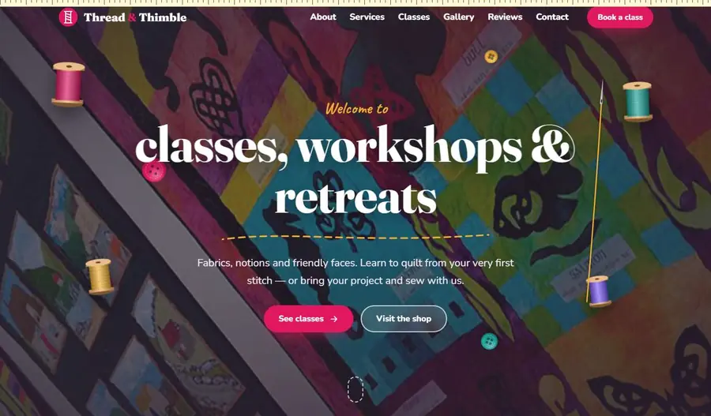

# Quilt shop template — Thread & Thimble

Quilt shop & sewing studio website template with 3D effects: needle-and-thread cursor, 3D push menu, flip cards, 3D carousel. Plain HTML/CSS/JS.

**Live demo:** https://abdelmoulabilel.github.io/quilt-shop-template/

## Use it
- Click **Use this template** on GitHub (or download the ZIP), then open `index.html` — no install, no build.
- Publish for free: repo **Settings → Pages → Deploy from branch → main / root**.

## Customise
Text in `index.html`, colours in `css/style.css` (`:root`), contact email in `js/main.js` (`CONTACT_EMAIL`).

Effects: 3D mouse-tilt hero with floating spools and buttons, a needle and thread that follow the cursor, 3D push menu, flip-cube links, 3D flip service cards, tape-measure scroll bar, stitched seams that draw on scroll, draggable 3D quilt carousel. Effects switch off for visitors who prefer reduced motion.

## Credits
Code: MIT licence (see `LICENSE`). Photos come from earlier client projects or theme demos and are for demonstration only — replace them with your own images.
